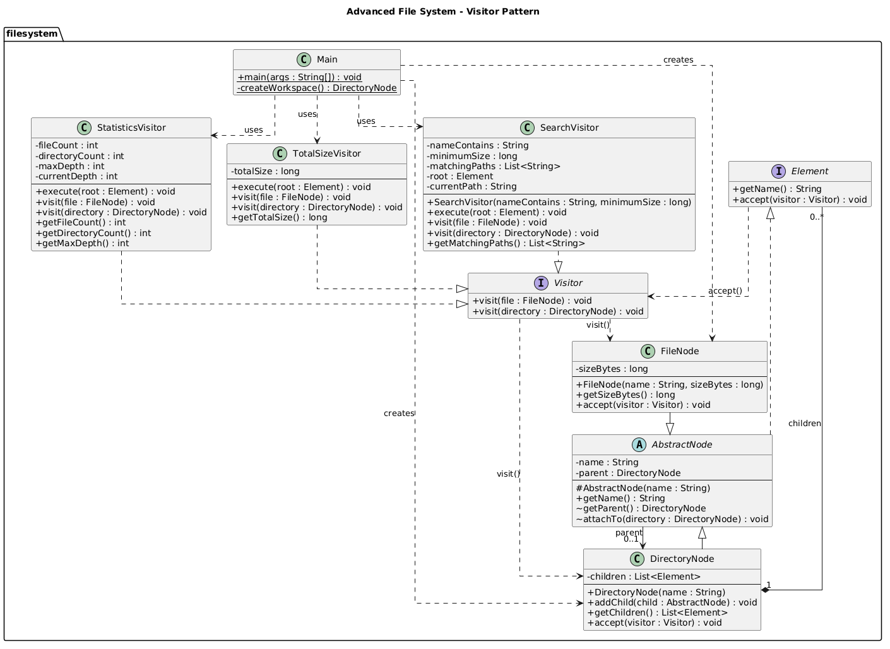

# Advanced File System — Visitor Pattern

## Project Overview

This project is a simple in-memory file system developed in Java 17 using the Visitor Design Pattern.

The system contains files and directories with multiple levels of nesting. It supports three independent operations:

- **TotalSizeVisitor** — calculates the total size of all files in bytes.
- **SearchVisitor** — searches for files using a name criterion and a minimum file size.
- **StatisticsVisitor** — counts files, directories, and the maximum tree depth.

The project demonstrates Double Dispatch, recursive traversal, and how new operations can be added without changing existing file system elements.

## Architecture

| Class / Interface | Responsibility |
|---|---|
| `Element` | Common interface for file system elements |
| `AbstractNode` | Stores the name and parent directory |
| `FileNode` | Represents a file with a name and size |
| `DirectoryNode` | Stores children and validates the tree structure |
| `Visitor` | Defines visit methods for files and directories |
| `TotalSizeVisitor` | Calculates the total file size |
| `SearchVisitor` | Finds files that match the search conditions |
| `StatisticsVisitor` | Collects file system statistics |
| `Main` | Creates a sample tree and runs the visitors |

Each element uses `accept()` to call the correct overloaded `visit()` method. This mechanism is called **Double Dispatch**.

Recursive traversal is handled by the visitors. The file system also prevents negative file sizes, duplicate sibling names, multiple parents, and cycles.

## UML Class Diagram

## Build and Run

**Requirements:**
- Java JDK 17
- Apache Maven
- JUnit 5 (managed by Maven)

Run the following commands from the project root.

**Compile the project:**

`mvn compile`

**Run the application:**

`java -cp target/classes filesystem.Main`

**Run all automated tests:**

`mvn test`

**Run the complete Maven verification:**

`mvn verify`

The project can also be built and tested using the Maven Lifecycle panel in IntelliJ IDEA.

## Demonstration Results

The application uses a sample file system with nested directories and files of different sizes.

**Total Size:**

`Total size: 1000 bytes`

**Search Results:**

Search conditions: filename contains `java` and minimum size is `150` bytes.

- `src/App.java`
- `src/utils/FileHelper.java`

**Statistics:**

| Metric | Result |
|---|---:|
| Files | 7 |
| Directories | 6 |
| Maximum depth | 3 |

The root directory has depth 0. Search results use relative paths with `/` separators and are sorted lexicographically.

## Automated Tests

The project uses JUnit 5 for automated testing.

| Test Class | Tests |
|---|---:|
| `DoubleDispatchTest` | 2 |
| `TotalSizeVisitorTest` | 4 |
| `SearchVisitorTest` | 6 |
| `StatisticsVisitorTest` | 5 |
| `FileSystemIntegrityTest` | 9 |
| **Total** | **26** |

**Test Results:**
- Tests run: 26
- Failures: 0
- Errors: 0
- Skipped: 0
- Build: SUCCESS

The tests cover Double Dispatch, recursive size calculation, search conditions, relative paths, statistics, empty structures, repeated executions, and invalid tree modifications.

## Extensibility

The Visitor Pattern allows new operations to be added without changing the existing element classes.

For example, `StatisticsVisitor` was added after `TotalSizeVisitor` and `SearchVisitor`. No changes were required in `Element`, `FileNode`, `DirectoryNode`, or their `accept()` methods.

However, adding a new element type would require changes to the `Visitor` interface and its implementations.

This is the main trade-off of the Visitor Pattern.